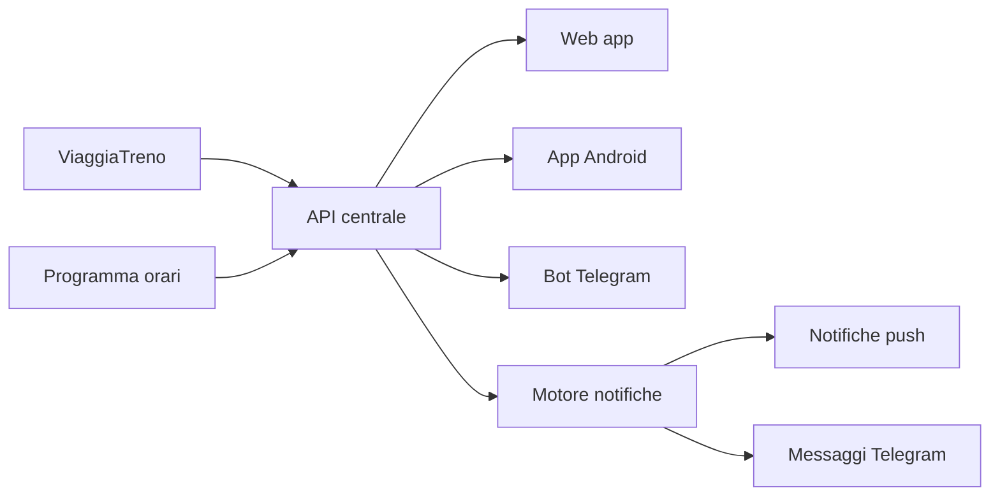

import Shots from '../../../components/Shots.astro';
import TrainNotification from '../../../components/TrainNotification.astro';
import TrainGlyphToy from '../../../components/TrainGlyphToy.astro';
import TrainHomeWidget from '../../../components/TrainHomeWidget.astro';
import shotQuando from '../../../assets/projects/trenitardo/02-per-quando-mobile.jpg';
import shotDomani from '../../../assets/projects/trenitardo/05-risultati-domani-mobile.jpg';
import shotChiaro from '../../../assets/projects/trenitardo/08-treno-chiaro-mobile.jpg';
import shotProgrammato from '../../../assets/projects/trenitardo/06-treno-programmato-mobile.jpg';

## Il problema

Sei sulla banchina alle 6:40. Il tabellone dice che il treno ha dieci minuti di ritardo. Poi venti. Poi
smette di dire qualcosa. È in arrivo? È fermo in mezzo alla campagna? Faccio in tempo a prendere un caffè?

Le app dei treni ti danno il ritardo, ma quasi mai la risposta che serve davvero: *dov'è adesso, e fra quanto
arriva da me.* I dati per saperlo esistono: li pubblica ViaggiaTreno. Ma sono pensati per un tabellone, non
per una persona con il telefono in mano, e a volte sono sbagliati o in ritardo anche loro.

Ho costruito Trenitardo per rispondere solo a quella domanda, sulla linea che uso: Verona–Brennero.

## Come funziona

Apri l'app. In alto, se stai già seguendo un treno, c'è una card piccola: dove si trova, fra quanti minuti
arriva alla tua fermata, di quanto è in ritardo. Il resto della schermata è la ricerca.

Scrivi da dove parti e dove vai (Trento, Verona). Accanto al tasto "Cerca" c'è un pulsantino "Quando": di
default è "Adesso", ma toccandolo scegli un altro giorno e un'altra ora con due ruote, come sull'iPhone.
Mentre cerca, una linea di puntini con quattro stazioni e una luce rossa che scende ti fa capire che sta
lavorando.

<Shots
  items={[
    { src: shotQuando, alt: "Il selettore del giorno e dell'ora, con Domani scelto e le ruote di ore e minuti", caption: 'Il selettore "Quando"' },
    { src: shotDomani, alt: 'I treni di domani alle 08:00 da Trento a Verona Porta Nuova, con gli orari programmati', caption: 'I treni di domani, alle 08:00' },
  ]}
/>

Arrivano i prossimi cinque treni. Ognuno dice dove va, a che ora arriva da te e in che stato è: ancora fermo,
in viaggio, già arrivato.

Tocchi un treno e compare il "tabellone": un riquadro scuro, a puntini come un display LED, con la fermata
dove si trova, il conto alla rovescia fino a te e il ritardo in rosso o in verde. Sotto, la lista delle
fermate con un pallino rosso che si sposta fra una stazione e l'altra. La fermata dove scendi è cerchiata di
bianco.

<Shots
  items={[
    { src: shotChiaro, alt: 'La vista del treno con il tema chiaro: interfaccia bianca ma tabellone sempre scuro', caption: 'Col tema chiaro il tabellone resta scuro' },
  ]}
/>

A questo punto scegli "Fino a Verona" e premi "Segui". Non serve più guardare lo schermo: arriva una notifica
quando il treno cambia stazione, quando il ritardo cresce, quando sta per arrivare da te.

<TrainNotification />

Se lo stesso viaggio è fra tre giorni, la schermata è la stessa, ma al posto del ritardo la hero dice quando
parte.

<Shots
  items={[
    { src: shotProgrammato, alt: 'Un treno di domani: al posto del ritardo il tabellone dice "Parte, domani, 08:10"', caption: 'Un treno di domani: il tabellone dice quando parte' },
  ]}
/>

Quello che ancora non c'è: le notifiche push dell'app Android a telefono "a riposo" (oggi vivono
finché il servizio dell'app resta attivo).

## Cosa sa fare

### Seguire un treno fino alla tua fermata

Scegli dove scendi e le notifiche si fermano lì. Se il treno parte fra ore, o fra giorni, l'avviso parte da
solo poco prima della partenza.

### Sapere dov'è, davvero

La posizione è filtrata: un treno non torna indietro, e un rilevamento strano non sposta il pallino sulla
stazione sbagliata. Se oltre 15 minuti dopo l'orario previsto non è ancora partito, lo dice in rosso.

### Orari fino a 60 giorni avanti

Scegli un giorno e un'ora e vedi i treni programmati, con durata e cambi. Un tocco apre le fermate, con una
nota onesta: gli orari reali compaiono il giorno del viaggio.

### I treni già passati oggi

Sono le 18 e vuoi vedere il treno delle 7: la lista c'è, con il ritardo finale e "arrivato". Utile per capire
cosa è successo, o per sapere se quel treno lo fa tutti i giorni in ritardo.

### Avvisi che servono

Treno cancellato, nessun aggiornamento da più di 15 minuti, non ancora partito, e un promemoria
"ricordati di timbrare" quando mancano un paio di fermate. Il testo del promemoria lo scegli tu.

### Condividere il viaggio

Un link con il treno e la fermata dove scendi: chi lo apre vede "Davide scende a Milano" e può seguirlo con un
tocco. Il nome davanti alle notifiche distingue i treni degli altri dai tuoi.

### Sul polso, nella home, sul retro del telefono

Un'app per lo smartwatch, i widget nella home di Android e un Toy per la Glyph Matrix del Nothing Phone 3,
che mostra il treno seguito con minuti e stazione.

### Anche da Telegram e dalla barra del PC

Un bot Telegram (comando `/t` per i treni, `/b` per i bus di Trento) e un plugin per la barra di ricerca
Essential Search, che risponde alla stessa domanda senza aprire niente.

## Sulla Glyph e nella home

Il treno che segui non resta chiuso nell'app. Sul retro del Nothing Phone 3 il Glyph Toy mostra i minuti
all'arrivo, un treno che corre quando è in viaggio e si ferma quando è in stazione, e la sigla di dove si trova.
Nella home di Android c'è un widget con la stessa informazione: fermata, minuti, ritardo.

<TrainGlyphToy />

<TrainHomeWidget />

## Sotto il cofano

**Il treno che tornava indietro.** ViaggiaTreno scrive l'"ultimo rilevamento" come testo libero, e a volte è
indietro di una fermata o è un punto fra due stazioni. All'inizio lo mostravo così com'era: il pallino
saltava indietro e sull'orologio compariva la stazione sbagliata. La regola che ha sistemato tutto è una sola:
l'indice della fermata corrente può solo crescere, e il rilevamento si mostra solo se è la fermata corrente, la
prossima o un punto fra due stazioni che non è in elenco. L'ho scritta una volta e poi copiata identica in
quattro posti (`app/src/trainState.js`, `android/.../follow/Position.kt`, `ritardobot/engine/trainTracker.js`
e `trainPosition` in `api/functions/routes.js`), perché PWA, app, motore delle notifiche e API devono dire la
stessa cosa. Lo stesso vale per i nomi delle stazioni: `matchStationName` cerca prima il nome esatto, poi la parola intera,
poi il testo contenuto, così un nome corto non trova stazioni che lo contengono per caso.

**Una fonte che non sa dire "domani".** ViaggiaTreno risponde vuoto per qualsiasi giorno che non sia oggi, e
la lista delle partenze azzera gli orari passati ad "adesso". Per i giorni futuri e per tornare indietro nella
giornata l'API interroga anche un'altra fonte pubblica con gli orari programmati (`programmaCorse`), e poi
arricchisce ogni risultato con i dati reali di ViaggiaTreno: ritardo finale, "arrivato", capolinea
(`corseDallOra`). Le fermate di un giorno futuro non esistono da nessuna parte, quindi si prendono dalla corsa
di oggi dello stesso numero; se oggi quel treno non circola, la pagina lo dice e mostra solo le tratte.

**Un allarme al posto di una notifica fissa.** Un servizio Android che segue un treno deve mostrare sempre una
notifica, quindi non può girare per ore prima della partenza. L'app programma invece un allarme esatto
(`FollowScheduler`) all'ora di partenza, e il servizio parte lì. Sul server succede la stessa cosa: il motore
registra il follow, resta muto e lo controlla ogni mezz'ora (un timer non regge giorni) finché è ora di
attivarlo. Il limite è onesto: sul piano gratuito di Render il file dei follow si perde a ogni riavvio.

**Un motore, tanti canali, e il giorno dei 403.** Tutta la logica dei dati sta in un solo servizio, e i client
(PWA, app, bot, widget) sono sottili. Il motore che decide *quando* avvisare non conosce il canale: emette
eventi ("partito", "fermo a", "arrivato", "cancellato") a un "sink", e un sink scrive su Telegram mentre un
altro manda notifiche push al browser. Un giorno, tutto si è fermato insieme: ViaggiaTreno aveva cominciato a
rispondere 403 alle richieste che non sembrano un browser. Con questa architettura il rimedio è stato di
una riga, nell'API (`routes.js`), e ha rimesso in piedi tutti i client insieme.

*Progetto indipendente: non è affiliato né sostenuto da Trenitalia, ViaggiaTreno, Nothing o Telegram. I marchi
citati appartengono ai rispettivi proprietari.*
